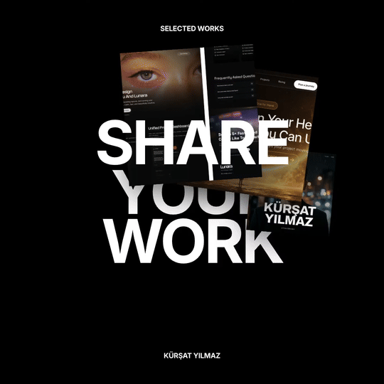

# Kürşat Yılmaz ⚡

**Tech Founder & AI Systems Architect** based in Istanbul.  
Founder of [itibar.app](https://itibar.app) & [unutma.app](https://unutma.app) · Author at [kursat.itibar.app](https://kursat.itibar.app)

  
  
  
  
  
  

---

### 🎬 Selected Works & Engineering Showcase

<table>
  <tr>
    <td width="50%" align="center" valign="top">
      
       
      <strong>Software Team & Selected Works</strong>
       
      Production SaaS MVPs, AI systems, and client architectures built end-to-end (<a href="https://itibar.app">itibar.app</a> · <a href="https://unutma.app">unutma.app</a>).
    </td>
    <td width="50%" align="center" valign="top">
      
       
      <strong>The Stack — Technical Writing & GEO Blog</strong>
       
      Architecture post-mortems, LLM/hardware benchmarks, and <code>llms.txt</code>-ready engineering analysis (<a href="https://kursat.itibar.app/blog">kursat.itibar.app/blog</a>).
    </td>
  </tr>
</table>

---

### 🛠 What I Build & Ship
- **Autonomous AI & Multi-Agent Pipelines:** Deterministic workflows, LangGraph, tool-calling agents, and real-time streaming architectures.
- **Full-Stack SaaS MVPs:** High-velocity Next.js 16 (App Router), TypeScript, Tailwind CSS v4, and PostgreSQL/Supabase systems.
- **Deep Technical Writing & GEO:** Architecture post-mortems, hardware/LLM benchmarks, and GEO (`llms.txt`) optimized developer documentation.

**Core Stack:** `Next.js` · `React` · `TypeScript` · `Python` · `FastAPI` · `LangGraph` · `PostgreSQL` · `Supabase` · `Tailwind CSS` · `Docker` · `Linux`

---

### 💼 Work With Me (Consulting & Contracts)
I am available for select high-impact contract roles:
- 🚀 **End-to-End SaaS MVPs:** From spec to live production deployment in 2–4 weeks.
- 🤖 **AI & Automation Pipelines:** Replacing manual ops with reliable Python/Node background engines.
- ✍️ **Technical Writing & DevRel:** Deep engineering articles and benchmarks for SaaS & DevTools companies.

📩 **Direct Inquiries:** `kursat@itibar.app`  
🌐 **Engineering Blog & Portfolio:** [kursat.itibar.app](https://kursat.itibar.app)  
🤝 **Contract / Freelance Escrow:** [Upwork Profile](https://www.upwork.com/freelancers/~0194776fc1f6b59652) · [Contra](https://contra.com/w/kursatyz)

---

  

